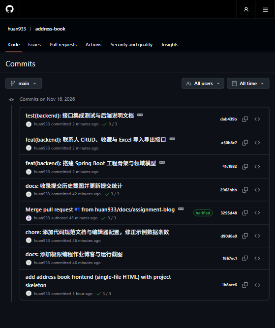
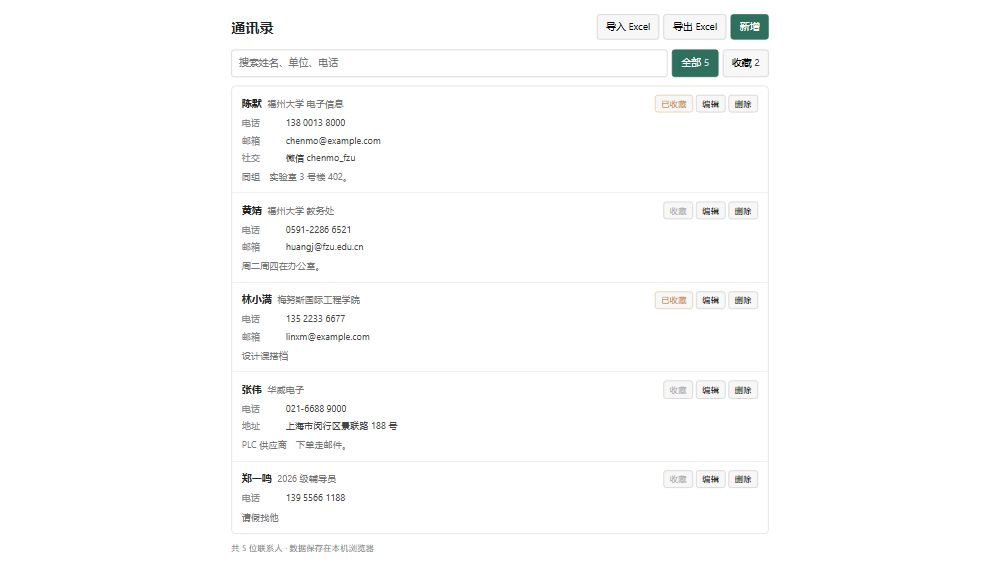

# 极限编程作业博客 · 通讯录 Address Book

| 项目 | 内容 |
| --- | --- |
| 本次作业课程 | 软件工程（Software Engineering，FZU–MU） |
| 小组名称 | 【待填：小组名称】 |
| 作业要求 | 用极限编程（Extreme Programming）方式完成一个「通讯录」Web 应用：实现收藏联系人、一个联系人挂多种联系方式、Excel 导入导出、页面样式；建立 GitHub 仓库（提交次数 ≥ 3）、发布一个版本并发起 Pull Request、撰写并提交作业博客；可选完成云服务器部署（+15 分） |
| 本次作业目标 | 体验 XP 的结对 / 小步交付流程：先拆模块再动手，以可运行的小版本 + 频繁提交推进；掌握「一人多联系方式」的数据建模与 Excel 扁平表之间的双向转换；学会用 Git 分支 + PR 管理一次可发布的变更 |
| 其他参考 | [仓库 README](https://github.com/huan933/address-book/blob/main/README.md)、[代码规范](https://github.com/huan933/address-book/blob/main/docs/code-style.md)、[SheetJS 文档](https://docs.sheetjs.com/) |

---

## 目录

- [1. 项目地址](#1-项目地址)
- [2. 团队分工与贡献比](#2-团队分工与贡献比)
- [3. 提交记录与贡献统计](#3-提交记录与贡献统计)
- [4. 功能实现思路](#4-功能实现思路)
  - [4.1 页面样式（10 分）](#41-页面样式10-分)
  - [4.2 收藏联系人（25 分）](#42-收藏联系人25-分)
  - [4.3 一个联系人多个联系方式（10 分）](#43-一个联系人多个联系方式10-分)
  - [4.4 导入与导出（25 分）](#44-导入与导出25-分)
  - [4.5 数据层、容错与安全](#45-数据层容错与安全)
- [5. 运行截图与演示视频](#5-运行截图与演示视频)
- [6. 协作中遇到的困难与解决](#6-协作中遇到的困难与解决)
- [7. PSP 表](#7-psp-表)
- [8. 评分标准对照自查](#8-评分标准对照自查)
- [9. 提交前待补充清单](#9-提交前待补充清单)

---

## 1. 项目地址

| 项目 | 地址 |
| --- | --- |
| GitHub 仓库 | https://github.com/huan933/address-book |
| 在线访问（GitHub Pages） | https://huan933.github.io/address-book/ |
| 发布版本（Release） | https://github.com/huan933/address-book/releases/tag/v1.0.0 |
| 代码规范 | https://github.com/huan933/address-book/blob/main/docs/code-style.md |
| Pull Request | https://github.com/huan933/address-book/pulls?q=is%3Apr |

**运行方式**（三种任选）：

1. 直接打开在线地址 `https://huan933.github.io/address-book/`；
2. 下载仓库，双击 `frontend/通讯录.html`（无需安装、无需构建、无需启动服务器）；
3. VS Code 打开项目，装 Live Server，右键 `frontend/通讯录.html` → Open with Live Server。

> 数据保存在浏览器 `localStorage`（键名 `xp.addressbook.v1`），刷新不丢；首次打开会自动写入 5 条示例联系人。

**技术选型**：原生 HTML5 + CSS3 + JavaScript（ES5，IIFE 隔离作用域），零框架、零构建、零依赖（唯一外部依赖是 CDN 上的 SheetJS，用于 Excel 读写）。选择单文件的原因：作业交付物是「一个能跑起来的通讯录」，单文件让评审方**下载即可运行**，也便于结对时两人在同一文件的不同函数区并行改动。

---

## 2. 团队分工与贡献比

| 成员 | 学号 | 负责模块 | 贡献比 |
| --- | --- | --- | --- |
| 黄（huan933） | 169073914 | 数据层与本地持久化、收藏功能、导入导出（Excel 表结构设计与双向解析）、Git 分支 / PR / Release、联调与文档 | 【待填】 |
| 【待填：队友姓名】 | 【待填】 | 页面样式与响应式布局、编辑区（多联系方式增删交互）、搜索与收藏视图、测试用例与运行录屏 | 【待填】 |
| **合计** | — | — | **100** |

> 说明：贡献比按实际投入工时与产出模块填写，两人合计 100。若为个人独立完成，请删除本表并在第 6 节注明「个人作业，无协作部分」。

**模块拆分（动手前的设计约定）**

| 模块 | 交付内容 | 接口约定 |
| --- | --- | --- |
| M1 数据层 | `store` / `load()` / `save()` / `uid()` | 对外只暴露 `store.contacts` 数组，元素字段固定为 `id/name/org/note/memo/favorite/methods/createdAt/updatedAt` |
| M2 渲染层 | `render()` / `visible()` | 只读 `store` + `ui`，不写数据；所有输出经 `esc()` |
| M3 编辑区 | `openEditor()` / `methodRow()` / 保存逻辑 | 一条联系方式 = `{type, value}`，`type ∈ phone/email/social/address/other` |
| M4 导入导出 | `exportRows()` / `importRows()` / `classify()` | 以 `HEADERS` 常量（12 列）为唯一契约，导出与导入必须能原样回灌 |

先定接口再并行写代码，是这次能在一个文件里两人同时改而不冲突的关键。

---

## 3. 提交记录与贡献统计



> 截图时间：2026-11-16，`main` 分支合并 PR 之后的状态。

| 贡献者 | 提交次数 | 说明 |
| --- | --- | --- |
| huan933 | 【待更新：见仓库 Commits 页】 | 初始项目骨架、博客与代码规范、提交历史截图 |
| 【待填：队友 GitHub 账号】 | 【待填】 | 【待填：负责模块对应的提交】 |
| **合计** | — | 满足作业要求（提交次数 ≥ 3） |

**主要提交节点**

| 提交 | 内容 |
| --- | --- |
| `1b8acc6` | 初始化仓库：单文件前端 + 项目骨架（`backend/`、`docs/`、`.vscode/`、`.gitignore`、README） |
| `docs/*` 分支 | 作业博客、运行截图、代码规范文档、`.editorconfig` |
| PR 合并 | 通过 Pull Request 把博客与文档合入 `main` |
| `v1.0.0` | 打标签并发布 Release（可发布版本） |

---

## 4. 功能实现思路

整体架构是一张「数据 → 视图 → 交互」的单向流水线：

```
localStorage ──load()──▶ store.contacts ──visible()──▶ render() ──▶ DOM
      ▲                        ▲                            │
      └──── save() ◀── 交互回调（收藏/编辑/删除/导入） ◀──────┘
```

任何一次改动都走「事件 → 改 `store` → `save()` → `render()`」这四步，因此**界面永远是数据的投影**，不存在两份状态互相打架的问题。这是全项目最核心的设计决定。

### 4.1 页面样式（10 分）

单列列表 + 顶部工具条 + 行内可折叠编辑区。要点：

- **零第三方 UI 库**，全部手写 CSS，配色只用两个语义色：主色 `#2f6f5e`（紫绿，用于主按钮与选中态）、收藏色 `#c8892b`（金色星标）。
- **状态用类名控制**：`.chip.on`、`.star.on`，JS 只负责切换 `className`，样式逻辑不散在代码里。
- **响应式只用一个断点**：`@media (max-width: 560px)` 时标签与输入框由「左右」改「上下」堆叠，工具条按钮等分铺满，手机上仍可单手操作。
- 反馈统一用 **toast**（2.4 秒自动消失），不使用 `alert` 打断操作流。

```css
@media (max-width:560px){
  .f{flex-direction:column;gap:4px}   /* 标签与输入框改为上下堆叠 */
  .tools{width:100%} .tools button{flex:1}
}
```

### 4.2 收藏联系人（25 分）

**数据**：每个联系人有布尔字段 `favorite`，随 `save()` 一起落盘，刷新后仍在。

**交互**：列表行右侧的星标按钮是一个「切换器」，已收藏显示「已收藏」并变为金色（`.star.on`）。

```js
if (act === 'fav') {
  c.favorite = !c.favorite;      // 切换收藏
  c.updatedAt = Date.now();
  save(); render();              // 立刻持久化 + 重绘
}
```

**便捷访问**：顶部两个 chip 即「视图切换器」——「全部」与「收藏」，计数实时反映：

```js
document.getElementById('c-fav').textContent =
  store.contacts.filter(function (c) { return c.favorite; }).length;
```

关键是**收藏不是另存一份列表**，而是给「视图过滤」加一个谓词：`visible()` 里 `if (ui.filter === 'fav' && !c.favorite) return false;`。这样收藏、搜索、排序三者天然可以叠加（收藏视图里再搜索也是通的），也不用担心两份数据不同步。

### 4.3 一个联系人多个联系方式（10 分）

**数据建模：一对多，用一个数组承载**，每条联系方式是 `{type, value}`：

```js
var TYPES = { phone:'电话', email:'邮箱', social:'社交', address:'地址', other:'其他' };
// 例：一位联系人
{ id:'c-xxx', name:'陈默', favorite:true,
  methods:[ {type:'phone', value:'138 0013 8000'},
            {type:'email', value:'chenmo@example.com'},
            {type:'social', value:'微信 chenmo_fzu'} ] }
```

**编辑交互**：编辑区里「联系方式」不是固定几个输入框，而是**可增删的行**——`+ 添加一条` 追加一行 `select`（类型）+ `input`（内容）+ `删除` 按钮；保存时遍历所有行，**只收集内容非空的行**：

```js
Array.prototype.forEach.call($methods.querySelectorAll('.mrow'), function (r) {
  var v = r.querySelector('input').value.trim();
  if (v) methods.push({ type: r.querySelector('select').value, value: v });
});
```

**列表展示**：每条联系方式渲染成一行，左侧固定宽度显示类型（`.m .t{width:62px}`），右侧是内容，因此电话/邮箱/社交/地址对齐成一列，一眼可扫。

**校验**：姓名必填、至少一条联系方式，否则 toast 提示并阻止保存——避免出现「有名无号」的脏数据，这条规则同时被导入逻辑复用。

### 4.4 导入与导出（25 分）

这是本作业最需要设计的一块：**一个人可能有 N 条联系方式，而 Excel 要求「一人一行、每类信息一列」**，两者结构并不一一对应。我们的做法是把「一对多」压成**固定列宽的分组列**，并保证导出与导入互为逆运算。

**列契约（唯一真相来源 `HEADERS`，共 12 列）：**

```js
var HEADERS = ['姓名','单位','收藏','备注',
               '电话1','电话2','电话3','邮箱1','邮箱2','社交1','社交2','地址'];
```

**导出**：按类型分组填列，超出列宽的部分合并进「地址」列，避免信息丢失：

```js
var b = { phone:[], email:[], social:[], address:[], other:[] };
(c.methods || []).forEach(function (m) { (b[m.type] || b.other).push(m.value); });
return [ c.name, c.org||'', c.favorite?'是':'否', c.note||'',
         b.phone[0]||'', b.phone[1]||'', b.phone[2]||'',
         b.email[0]||'', b.email[1]||'',
         b.social[0]||'', b.social[1]||'',
         b.address.concat(b.other).join('；') ];
```

写成 `xlsx`（`XLSX.writeFile`），文件名带时间戳（`通讯录_20261116_2130.xlsx`）；导出前按姓名排序，方便核对。

**导入**：不假设表头位置，而是**在前 5 行内自动找表头行**，并用正则把中文/英文字段名归类到规范列：

```js
function classify(h) {
  h = String(h).replace(/\s/g,'').toLowerCase();
  if (/姓名|名字|name/.test(h)) return 'name';
  if (/电话|手机|tel|phone/.test(h)) return 'phone';
  if (/邮箱|邮件|email|mail/.test(h)) return 'email';
  if (/社交|微信|wechat|social/.test(h)) return 'social';
  if (/地址|address/.test(h)) return 'address';
  /* 单位 / 收藏 / 备注 / 说明 同理 */
}
```

导入时逐行处理：**缺姓名或没有任何联系方式的行丢弃并计数**；**与现有联系人重名则跳过并计数**（作业场景里防止重复导入同一份表）。结束后用一条 toast 汇总「新增 N、重名跳过 M、无效 K」。

**容错设计（两处）**：

1. SheetJS 从 CDN 加载，**断网时 Excel 组件不可用**——导出自动降级为 UTF-8 BOM 的 CSV（Excel 可直接打开），并提示「未联网，已改为导出 CSV」；
2. 导入前先检查 `typeof XLSX === 'undefined'`，提示「Excel 组件未加载，需要联网」，绝不静默失败。

**自测方式**：导出 → 清空浏览器数据 → 导入刚导出的文件，联系人、收藏状态、多联系方式应完全还原（导出/导入格式对齐，可原样回灌）。

### 4.5 数据层、容错与安全

| 问题 | 处理方式 |
| --- | --- |
| 刷新丢数据 | `save()` 把整个 `store` 序列化进 `localStorage`；`load()` 解析失败或结构不对时回退到种子数据 |
| 浏览器禁用存储 | `save()` 包 `try/catch`，失败 toast 提示「浏览器存储不可用」，页面仍可操作 |
| XSS 注入 | 所有进入 `innerHTML` 的用户数据（姓名、单位、备注、联系方式）一律经 `esc()` 转义 5 个字符 |
| 同名联系人 | 导入时按姓名去重；手动新增不做限制（允许同名不同人） |
| 全局污染 | 全部逻辑在 `(function(){ 'use strict'; ... })()` 内，不向 `window` 挂任何变量 |

---

## 5. 运行截图与演示视频

**桌面浏览器（全部视图 + 收藏计数 + 多联系方式）**



**手机窄屏（560px 断点后的单列布局）**


**完整运行视频**

视频文件：【待填：运行录屏，建议上传网盘后贴链接，或直接作为附件提交】

录制脚本（按此顺序录一遍约 1–2 分钟，即可完整覆盖 70 分编码项）：

| 步骤 | 操作 | 展示要点 |
| --- | --- | --- |
| 1 | 打开在线地址 / 双击 `frontend/通讯录.html` | 页面样式、示例数据、底部「共 5 位联系人」 |
| 2 | 点某人的「收藏」→ 切到「收藏」视图 | 星标变金色、按钮文案变「已收藏」、收藏计数 +1、列表只剩收藏项 |
| 3 | 在收藏视图里输入搜索词 | 收藏与搜索可叠加过滤 |
| 4 | 点「新增」：填姓名 + 连续点两次「+ 添加一条」，选「电话 / 邮箱 / 社交」各填一条，保存 | 一个联系人挂多种联系方式 |
| 5 | 编辑该联系人：删掉一行联系方式再保存 | 联系方式可增可减 |
| 6 | 点「导出 Excel」，打开下载的文件 | 一人一行、12 列、收藏为「是/否」 |
| 7 | 清空浏览器数据（或开无痕窗口）后点「导入 Excel」，选刚导出的文件 | 数据完整回灌，toast 显示「新增 5」 |
| 8 | 再次导入同一文件 | 提示「重名跳过」，验证去重 |
| 9 | 把窗口拉窄到手机宽度 | 单列堆叠的响应式布局 |

---

## 6. 协作中遇到的困难与解决

| 困难 | 现象 | 解决方式 |
| --- | --- | --- |
| 两人在同一个 HTML 文件里并行改，容易互相覆盖 | 同时编辑会冲突，且单文件没有模块边界 | 动手前先按「数据层 / 渲染层 / 编辑区 / 导入导出」划好函数区，并约定**公共接口**（`store`、`render()`、`HEADERS`）；各自只动自己的函数区，改动集中在文件不同位置，冲突面被压到最小 |
| 「一人多联系方式」与 Excel「一人一行」的结构矛盾 | 直接导出会出现一个联系人占多行，或一列塞多个号码无法解析 | 先定 `HEADERS` 12 列的分组列契约（电话 1–3、邮箱 1–2、社交 1–2、其余并入地址列），导出与导入**共用同一份列定义**，互为逆运算；用「导出再导入」做回归自测 |
| 导入表格的表头不可控（老师/同学给的表可能多一列、少一列、表头在第 2 行） | 固定列序读取会错位 | 不按列序读，改为**表头识别 + 前 5 行探测**：用正则把表头归类到规范字段，找不到「姓名」列就明确报错而不是导入垃圾数据 |
| SheetJS 依赖联网，断网演示会翻车 | 导出直接报错或导出空文件 | 导出路径做**双分支**：有 `XLSX` 走 xlsx，没有则生成带 BOM 的 CSV；导入前先检查组件是否就绪并给出明确提示 |
| 用 `innerHTML` 拼列表有 XSS 风险（姓名里带 `<` 就能破坏页面） | 特殊字符导致页面结构错乱 | 统一 `esc()` 转义后再插入，所有用户数据走同一个出口 |
| GitHub 网络偶发连接重置（`Recv failure: Connection was reset`） | `git push` / `ls-remote` 第一次失败 | 重试即可恢复；同时把「小步提交」当作兜底——每次只推一个提交，失败重试成本低 |

**协作流程（XP 小步交付）**：先定模块与接口 → 各自在分支上完成一个可运行的小功能 → 合并、跑一遍「导出再导入」的手工回归 → 下一个功能。版本以 `v1.0.0` 发布，变更通过 Pull Request 合入 `main`。

---

## 7. PSP 表

> 以下为两名成员的 PSP 记录（单位：分钟）。**标注「估算」的行为按模块工作量给出的参考值，提交前请按实际工时替换**——PSP 的意义在于计划和实际的偏差，请保留你真实的数字。

### 7.1 成员 A（黄，169073914）

| 阶段 | 计划耗时 | 实际耗时 | 备注 |
| --- | --- | --- | --- |
| 计划 Planning | 30 | 【估算 40】 | 读作业要求、拆 4 个模块、定 `HEADERS` 列契约 |
| 需求分析 Analysis | 20 | 【估算 25】 | 明确「收藏」「多联系方式」「导入导出」的验收口径 |
| 设计 Design | 40 | 【估算 60】 | 数据结构（`contact` + `methods[]`）、Excel 分组列方案 |
| 编码 Code | 120 | 【估算 180】 | 数据层、收藏、导入导出、去重与降级 |
| 测试 Test | 60 | 【估算 75】 | 导出再导入、断网降级、同名去重、异常表头 |
| 文档 Documentation | 40 | 【估算 90】 | README、代码规范、本博客 |
| 复盘 Postmortem | 20 | 【估算 15】 | 记录困难与改进点 |
| **合计** | **330** | **【485】** | — |

### 7.2 成员 B（【待填：队友姓名】）

| 阶段 | 计划耗时 | 实际耗时 | 备注 |
| --- | --- | --- | --- |
| 计划 Planning | 30 | 【待填】 | 参与模块拆分与接口约定 |
| 需求分析 Analysis | 20 | 【待填】 | 页面样式与交互验收标准 |
| 设计 Design | 40 | 【待填】 | 列表/编辑区布局、560px 断点方案 |
| 编码 Code | 120 | 【待填】 | 页面样式、编辑区多行联系方式增删、搜索与收藏视图 |
| 测试 Test | 60 | 【待填】 | 手机窄屏、增删联系方式、搜索叠加收藏 |
| 文档 Documentation | 40 | 【待填】 | 运行录屏、截图、博客分工部分 |
| 复盘 Postmortem | 20 | 【待填】 | 协作困难记录 |
| **合计** | **330** | **【待填】** | — |

---

## 8. 评分标准对照自查

| 评分项 | 分值 | 完成情况 | 自查证据 |
| --- | --- | --- | --- |
| 博客格式（Markdown）、仓库与代码规范链接正确 | 10 | ✅ | 本文；仓库 + `docs/code-style.md` 链接均在第 1 节 |
| 功能实现思路、程序截图、成员分工 | 20 | ✅ | 第 4 节实现思路 + 第 5 节截图 + 第 2 节分工表 |
| 页面样式 | 10 | ✅ | 第 4.1 节；单列列表 + 编辑区 + 响应式断点 + toast |
| 收藏联系人 | 25 | ✅ | 第 4.2 节；星标切换、收藏视图、计数、持久化 |
| 一个联系人多个联系方式 | 10 | ✅ | 第 4.3 节；`methods[]` + 可增删行 + 类型区分 |
| 导入导出 | 25 | ✅ | 第 4.4 节；12 列契约、表头识别、去重、离线降级 |
| 云服务器部署（可选） | +15 | ⚠️ 部分 | 目前部署在 **GitHub Pages**（云托管静态站点，非 ECS 云服务器）。若老师严格要求华为云/阿里云 ECS，需另行部署 |
| 仓库提交 ≥ 3 次 | — | ✅ | 第 3 节 |
| 发布版本 + 发起 PR | — | ✅ | Release `v1.0.0` + Pull Request |

---

## 9. 提交前待补充清单

- [ ] 第 1 节表格「小组名称」填真实组名
- [ ] 第 2 节队友姓名、学号、两人贡献比（合计 100）
- [ ] 第 3 节队友 GitHub 账号与其提交次数（若队友未直接提交，请队友至少 push 一次，否则提交统计只有一人）
- [ ] 第 5 节运行视频链接（或作为附件提交）
- [ ] 第 7 节 PSP 表的「实际耗时」按真实工时替换（当前标注「估算」）
- [ ] 确认课程要求的博客发布平台（博客园 / CSDN / 其他），发布后等待审核
- [ ] 如需加分，补充云服务器（ECS）部署并更新在线地址
